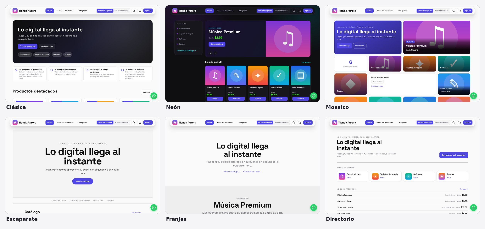
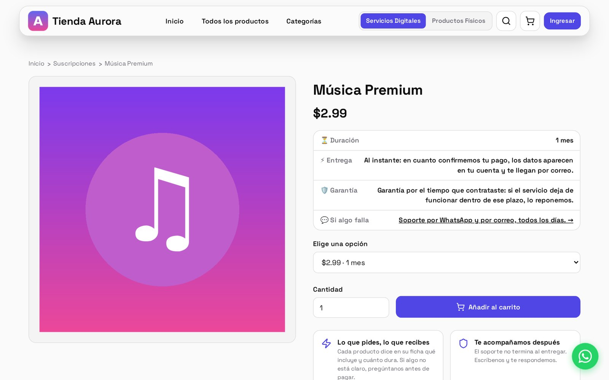
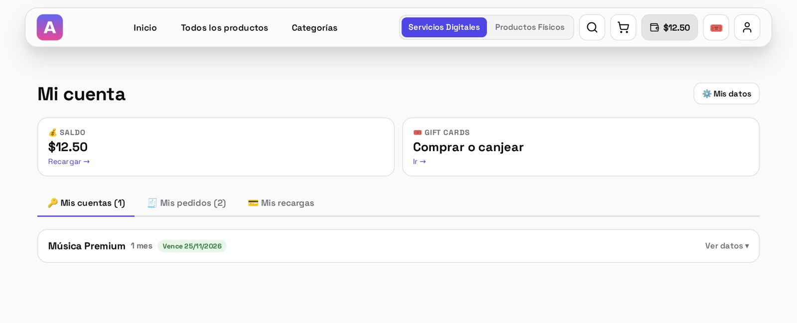
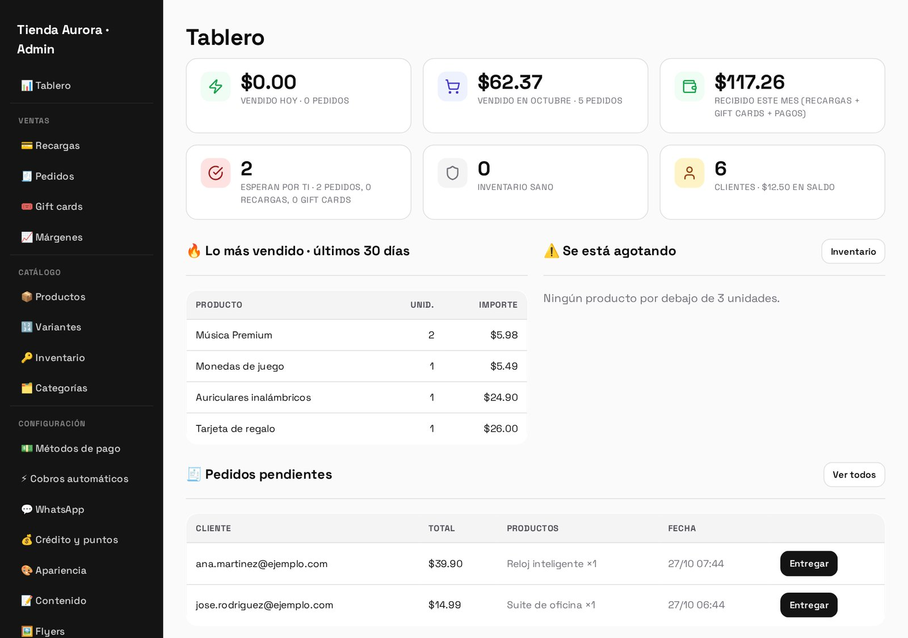
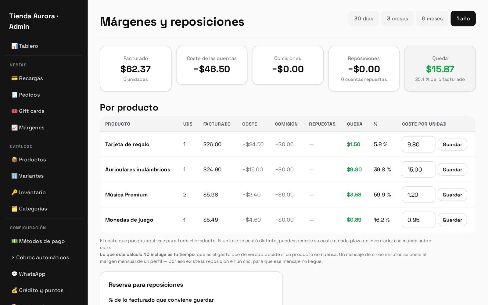
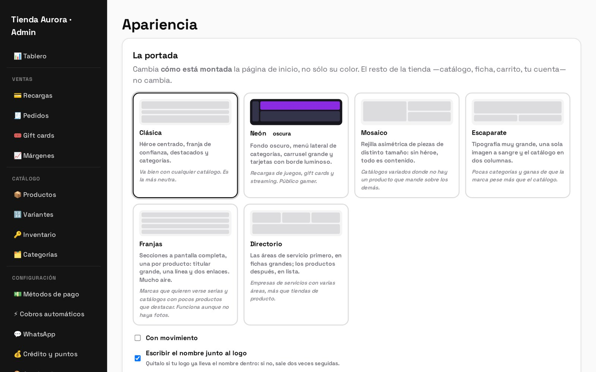
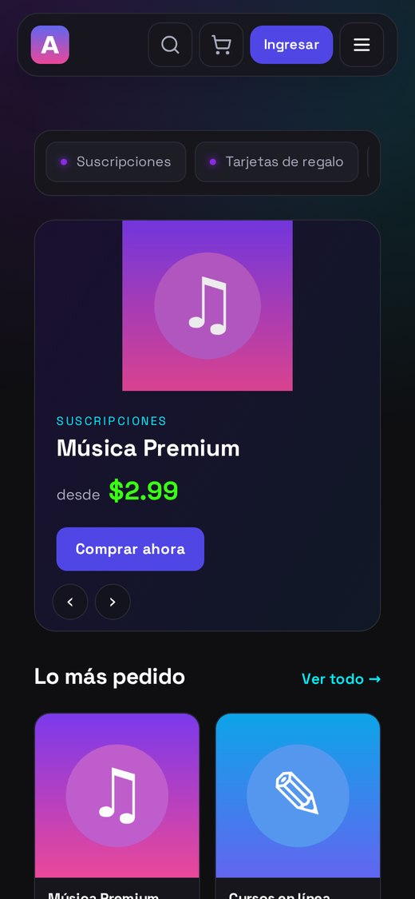
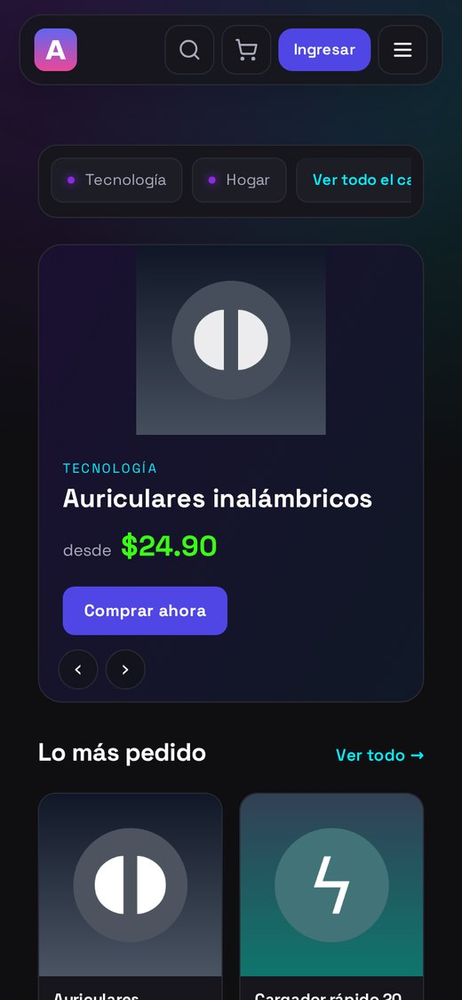
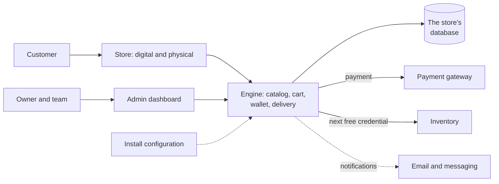

# Online store engine

> Your own store, on your own domain: digital, physical or both at once. Digital
> products deliver themselves as soon as payment is confirmed, and physical ones
> ship with their delivery details. Everything is run from a dashboard, without
> touching code.

**Status:** in production in 7 stores ·
**Proprietary system** by Kusarive Solutions LLC ·
[Versión en español](README.md) ·
[Presentation page](https://rjblancos.github.io/tienda-web-automatica-showcase/) ·
**[Download the presentation as PDF](presentacion/Motor-de-tiendas-presentacion.pdf)** (13 slides, in Spanish)

---

*The same demo store with each of the six home layouts. It is switched with one
click from the dashboard. The interface is in Spanish.*

## The problem

Whoever sells subscriptions, licenses, gift cards or physical products over chat
spends the day confirming payments and sending details by hand. Asleep, they
don't sell. Mix up a customer, and they deliver twice.

The engine turns that business into a store that runs itself. The customer
chooses and pays and, for an in-stock digital product, gets the details
instantly in their account and by email. The owner only handles what truly
needs a person.

## What it does

- **Two stores in one site.** Digital services and physical products, each with
  its own catalog, or just one of them.
- **Automatic delivery.** The inventory of credentials and keys is loaded in
  batches, and every sale delivers the next available one with no human
  involvement. Out of stock, the order waits for manual delivery.
- **Subscriptions with renewals.** Each variant has its own duration, the
  customer sees when it expires, and the store reminds them beforehand.
- **One-click replacement.** If a service fails within its warranty, it is
  replaced from the dashboard without charging again.
- **Wallet, gift cards and points.** A rechargeable balance, gift cards that can
  be bought and redeemed, and points per purchase.
- **Automatic or manual payment.** A connected gateway that confirms on its own,
  payment receipts with review, and fees and discounts per payment method.
- **Prices in dollars, with the local-currency equivalent** if the store charges
  in it, and several exchange rates to choose from.
- **Margins and replacements.** The dashboard shows what is left of each sale
  after cost, fees and replacements.
- **Six home layouts, light or dark mode and custom colors.** The store carries
  the owner's brand, not ours.
- **Legal texts with each store's real details**, generated by the engine.
- **Email and messaging notifications** to the customer and the owner.
- **Team roles.** Administration and staff, with their own prices for the team.
- **App mode.** The same store runs inside the brand's own mobile app.
- **Administrator's manual** included in the dashboard.

## Benefits

| For the store owner | |
|---|---|
| **Sells while asleep** | Digital products deliver themselves, at any hour. |
| **Their brand, their domain, their customers** | None of our branding on show; the customers and the data are theirs. |
| **Runs it all without coding** | Catalog, prices, home layout, colors, texts and payments come from the dashboard. |
| **Knows what they earn** | Real margin per product, with cost, fees and replacements. |
| **Digital, physical or both** | One store for everything they sell. |

| For us, who install and maintain it | |
|---|---|
| **From-scratch install on a new domain** | One tool creates the store, another applies migrations, another checks that it really works. |
| **One codebase for all of them** | What differs between stores lives in their config and their database, never in the code. One improvement reaches them all. |
| **A whole catalog at once** | A full catalog is loaded from a spreadsheet, without duplicates. |

## Screenshots

| Product page | Customer area |
|---|---|
|  |  |

| Dashboard | Margins and replacements |
|---|---|
|  |  |

| Appearance: the home layout is picked in the dashboard | On mobile |
|---|---|
|  |   |

Demo store with made-up data.

## Architecture

Each store is an independent install: its own domain, database, catalog,
payments and customers. The code is the same everywhere, and the only things
that set them apart are one config file and their dashboard settings. That is
why an improvement reaches every store without overwriting anyone's work.

## Technical guarantees

| Area | What the system guarantees |
|---|---|
| **Money** | The books balance to the cent: balances are the sum of their movements, and points the sum of their transactions. |
| **Delivery** | A credential is assigned only once; failed accounts are flagged and replaced. |
| **Installation** | The checker only passes when the install truly works: database, administrator, email, payment notifications, routes and cache. Every check is built so it can fail. |
| **Performance** | Server response around 10 ms, a single stylesheet and no third-party libraries in the interface. |
| **Accessibility** | Contrast measured against each brand's colors, and no animations for visitors who ask for reduced motion. |
| **Responsive design** | Checked from 390 to 1920 px wide: the menu bar and the dashboard never wrap or overflow. |

## Built with

| Language | Where | Approximate size |
|---|---|---|
| **PHP** | The store, customer area, dashboard and engine, no framework | 14,000 lines |
| **PHP** | Installer, migrations, catalog loader and checker | 2,700 lines |
| **CSS and JavaScript** | The interface and the six home layouts, no libraries | 1,800 lines |
| **SQL** | The schema and its migrations | 1,000 lines |

GitHub's language bar only measures the files in this repository, which is
documentation.

## Results

Real figures from the 7 stores in production, read on 27-Oct-2026. They include
the history each store brought along when it moved to the engine:

- **More than 1,800 orders delivered**, for **more than USD 19,000**.
- **More than 4,700 accounts and keys delivered.**
- **700 products** on sale.

## Want your own store?

We install the engine on your domain with your brand, your catalog and your
payment methods, and we keep it up to date.

Rafael Blanco, for Kusarive Solutions LLC

- Web: [kusarive.us](https://kusarive.us)
- Email: info@kusarive.us
- WhatsApp: [+1 407 337 0061](https://wa.me/14073370061)
- Presentation: [13-slide PDF](presentacion/Motor-de-tiendas-presentacion.pdf) (in Spanish)

© 2026 Kusarive Solutions LLC. See [LICENSE](LICENSE).
