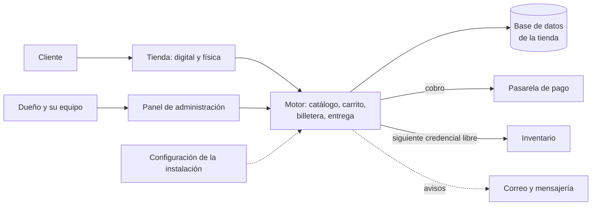

# Motor de tiendas en línea

> Tu tienda propia, en tu dominio: digital, física o las dos a la vez. Lo
> digital se entrega solo en cuanto se confirma el pago, y lo físico sale con
> sus datos de envío. Todo se maneja desde un panel, sin tocar código.

**Estado:** en producción en 7 tiendas ·
**Sistema propietario** de Kusarive Solutions LLC ·
[English version](README.en.md) ·
[Página de presentación](https://rjblancos.github.io/tienda-web-automatica-showcase/) ·
**[Descargar la presentación en PDF](presentacion/Motor-de-tiendas-presentacion.pdf)** (13 diapositivas)

---

*Una misma tienda de demostración con cada una de las seis portadas. Se cambia
con un clic desde el panel.*

## Qué resuelve

Quien vende suscripciones, licencias, tarjetas de regalo o productos físicos
por mensajería pasa el día confirmando pagos y enviando datos a mano. Si
duerme, no vende. Si se equivoca de cliente, entrega dos veces.

El motor convierte ese negocio en una tienda que trabaja sola. El cliente elige,
paga y, si es un producto digital con existencias, recibe sus datos al instante
en su cuenta y por correo. El dueño solo atiende lo que de verdad necesita a una
persona.

## Qué hace

- **Dos tiendas en un solo sitio.** Servicios digitales y productos físicos, cada
  uno con su catálogo, o solo uno de los dos.
- **Entrega automática.** El inventario de credenciales y claves se carga por
  lotes, y cada venta entrega la siguiente disponible sin intervención humana.
  Sin existencias, el pedido queda pendiente de entrega manual.
- **Suscripciones con renovación.** Cada variante tiene su duración, el cliente
  ve cuándo le vence y la tienda le avisa antes.
- **Reposición en un clic.** Si un servicio falla dentro de la garantía, se repone
  desde el panel sin volver a cobrar.
- **Billetera, tarjetas de regalo y puntos.** Saldo recargable, tarjetas de regalo
  que se compran y se canjean, y puntos por compra.
- **Cobro automático o manual.** Pasarela conectada con confirmación sola,
  comprobante de pago con revisión, comisiones y descuentos por método de pago.
- **Precios en dólares, con su equivalente en moneda local** si la tienda cobra en
  ella, y varias tasas de cambio a elegir.
- **Márgenes y reposiciones.** El panel enseña cuánto queda de cada venta después
  del coste, las comisiones y las reposiciones.
- **Seis portadas, modo claro u oscuro y colores propios.** La tienda tiene la marca
  del dueño, no la nuestra.
- **Textos legales con los datos reales** de cada tienda, generados por el motor.
- **Avisos por correo y por mensajería** al cliente y al dueño.
- **Equipo con roles.** Administración y trabajadores, con precios propios para
  el equipo.
- **Modo app.** La misma tienda funciona dentro de una app móvil de la marca.
- **Manual de uso** del administrador incluido en el panel.

## Beneficios

| Para el dueño de la tienda | |
|---|---|
| **Vende mientras duerme** | Lo digital se entrega solo, a cualquier hora. |
| **Su marca, su dominio, sus clientes** | Nada de nuestra marca a la vista; los clientes y los datos son suyos. |
| **Lo maneja todo sin programar** | Catálogo, precios, portada, colores, textos y cobros salen del panel. |
| **Sabe cuánto gana** | Margen real por producto, con coste, comisiones y reposiciones. |
| **Digital, físico o los dos** | Una sola tienda para todo lo que vende. |

| Para nosotros, que lo instalamos y mantenemos | |
|---|---|
| **Instalación de cero en un dominio nuevo** | Un instalador crea la tienda; otro aplica las migraciones; otro comprueba que todo funcione de verdad. |
| **Un solo código para todas** | Lo que cambia entre tiendas vive en su configuración y en su base de datos, nunca en el código. Una mejora llega a todas. |
| **Catálogo de un tirón** | Se carga un catálogo entero desde una hoja de cálculo, sin duplicar. |

## Capturas

| Ficha de producto | Área del cliente |
|---|---|
|  |  |

| Tablero del panel | Márgenes y reposiciones |
|---|---|
|  |  |

| Apariencia: la portada se elige en el panel | En el móvil |
|---|---|
|  |   |

Tienda de demostración con datos inventados.

## Arquitectura

Cada tienda es una instalación independiente: su dominio, su base de datos, su
catálogo, sus cobros y sus clientes. El código es el mismo en todas, y lo único
que las distingue es un fichero de configuración y sus ajustes del panel. Por
eso una mejora se propaga a todas sin pisar nada de nadie.

## Garantías técnicas

| Área | Qué garantiza el sistema |
|---|---|
| **Dinero** | La contabilidad cuadra al céntimo: los saldos son la suma de sus movimientos y los puntos la suma de sus transacciones. |
| **Entrega** | Una credencial se asigna una sola vez; las cuentas caídas se marcan y se reponen. |
| **Instalación** | El verificador da verde solo si la instalación funciona de verdad: base de datos, administrador, correo, aviso de cobros, rutas y caché. Cada comprobación está hecha para poder fallar. |
| **Rendimiento** | Respuesta del servidor de unos 10 ms, una sola hoja de estilos y ninguna librería de terceros en la interfaz. |
| **Accesibilidad** | Contraste medido en los colores de cada marca, y sin animaciones para quien pide reducir movimiento. |
| **Diseño adaptable** | Comprobado de 390 a 1920 px de ancho: la barra y el panel no se parten ni se desbordan. |

## Construido con

| Lenguaje | Dónde | Tamaño aproximado |
|---|---|---|
| **PHP** | La tienda, el área del cliente, el panel y el motor, sin framework | 14.000 líneas |
| **PHP** | Instalador, migraciones, carga de catálogo y verificador | 2.700 líneas |
| **CSS y JavaScript** | La interfaz y las seis portadas, sin librerías | 1.800 líneas |
| **SQL** | El esquema y sus migraciones | 1.000 líneas |

La barra de lenguajes de GitHub mide solo los ficheros de este repositorio, que
es documentación.

## Resultados

Cifras reales de las 7 tiendas en producción, leídas el 27-oct-2026. Incluyen el
historial que cada tienda trajo al migrar al motor:

- **Más de 1.800 pedidos entregados**, por **más de 19.000 USD**.
- **Más de 4.700 cuentas y claves entregadas.**
- **700 productos** a la venta.

## ¿Quieres tu tienda?

Instalamos el motor en tu dominio con tu marca, tu catálogo y tus métodos de
cobro, y lo mantenemos al día.

Rafael Blanco, para Kusarive Solutions LLC

- Web: [kusarive.us](https://kusarive.us)
- Correo: info@kusarive.us
- WhatsApp: [+1 407 337 0061](https://wa.me/14073370061)
- Presentación: [PDF de 13 diapositivas](presentacion/Motor-de-tiendas-presentacion.pdf)

© 2026 Kusarive Solutions LLC. Ver [LICENSE](LICENSE).
